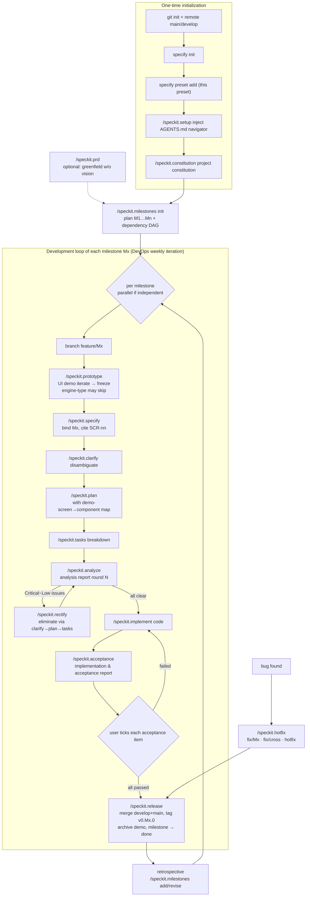

# Milestone-Driven Development Workflow

**Plan milestones first, then run each through a full "UI Demo → Specify → Plan → Tasks → Analyze/Rectify → Implement → Acceptance → Release" loop.**

English | [简体中文](README.zh-CN.md)

A [spec-kit](https://github.com/github/spec-kit) preset that extends spec-driven development (SDD) into a **milestone-driven** end-to-end workflow — plan milestones up front, then drive every milestone through a complete "UI Demo → Specify → Plan → Tasks → Analyze/Rectify → Implement → Acceptance → Release" cycle, with DevOps-style iteration and dual-path bug fixes.

| | |
| --- | --- |
| Version | 1.3.1 ([CHANGELOG](CHANGELOG.md)) |
| Requires | spec-kit CLI >= 0.5.0 (verified on v0.14.4) |
| License | [MIT](LICENSE) |

## What It Solves

Stock spec-kit covers "how one feature goes from spec to code" — but not:

- **How a whole system ships in stages** — this preset plans it via a milestones file (one milestone = one module = one specify = one feature/Mx branch), with a dependency DAG enabling parallel development.
- **Ambiguity hiding in the UI** — a UI demo is iterated and frozen *before* specify (a visual prototype is the most efficient disambiguation tool).
- **What to do after analysis finds problems** — analysis reports persist per round, paired with a clarify→plan→tasks rectification loop: Critical through Low are all eliminated immediately, with closed-loop verification.
- **When a milestone counts as "done"** — the Implementation & Acceptance Report includes per-item manual acceptance guides; merge and release only after the user ticks every box.
- **Users not knowing which command comes next** — at setup time, a workflow-navigator block is injected into AGENTS.md (speckit.setup), so the agent ends every reply with the current stage and available required/optional actions; removable at any time.

## Installation

Inside an initialized spec-kit project (after `specify init`):

~~~bash
# Option A: install from the GitHub release archive (recommended)
specify preset add --from https://github.com/sigentech/speckit-preset-milestone-driven-dev/archive/refs/tags/v1.3.1.zip

# Option B: install from a local directory (development)
specify preset add --dev /path/to/speckit-preset-milestone-driven-dev

# Verify
specify preset info milestone-driven-dev
specify preset resolve milestones-template
~~~

specify preset resolve milestones-template
~~~

## When to Use / When Not

**Good fit**: long-term iterative development of mid-to-large systems; solo developers or small teams working with AI coding; projects that need every stage verifiable and traceable.
**Not for**: one-off scripts or toy projects (process overhead outweighs the gain); purely exploratory prototypes (consider running only this preset's prototype stage).

## Quick Start (New Project)

~~~bash
# 1. Git & remote: main = release branch, develop = integration branch
git init && git add -A && git commit -m "chore: initial commit"
git branch -M main
git remote add origin <your-remote-repo-url>
git push -u origin main
git checkout -b develop && git push -u origin develop

# 2. Initialize spec-kit and install this preset
specify init --here --integration codex      # or claude / copilot, etc.
specify preset add --from https://github.com/sigentech/speckit-preset-milestone-driven-dev/archive/refs/tags/v1.3.1.zip

# 3. Inject the AGENTS.md workflow navigator (agent suggests next steps after every reply)
/speckit.setup

# 4. Project constitution: pin the tech-stack floor, quality gates, branch discipline
/speckit.constitution

# 5. Milestone planning (feature vision → M1…Mn + dependency DAG)
/speckit.milestones init
#   Greenfield projects without a vision source may run /speckit.prd first

# 6. Per-milestone development loop (see flowchart), starting from M1
/speckit.prototype gen M1
~~~

## Full Flowchart (Which Command at Which Stage)

**Three human actions that cannot be waived**: milestone-plan confirmation, ticking each manual acceptance item, and final confirmation before release. All other steps default to AUTO (agent executes + gate checks), with human intervention possible on any artifact at any step.

**Three human actions that cannot be waived**: milestone-plan confirmation, ticking each manual acceptance item, and final confirmation before release. All other steps default to AUTO (agent executes + gate checks), with human intervention possible on any artifact at any step.

## The Milestone Loop (Ten Steps per Mx)

| Step | Command | Artifact / Action | Gate |
| --- | --- | --- | --- |
① | (branch) | `git checkout -b feature/Mx` (handled inside prototype/specify) | cut from develop |
② | speckit.prototype | `specs/NNN-mX-slug/prototype/` (HTML demo + prototype.md) | inherits UX baseline; **user-confirmed freeze** after iteration; engine-type may skip |
③ | speckit.specify | `specs/NNN-mX-slug/spec.md` (UI-contract section citing SCR-nn) | demo frozen/degraded; milestone bound; scope within bounds |
④ | speckit.clarify | spec.md disambiguation | zero vague wording |
⑤ | speckit.plan | plan.md (with demo-screen→component map) | constitution-compliant; no interactions the demo lacks |
⑥ | speckit.tasks | tasks.md | spec↔plan↔tasks aligned |
⑦ | speckit.analyze | analysis report (round N, see Configuration) | severity-graded, persisted |
⑦' | speckit.rectify | updated spec/plan/tasks + elimination log | Critical~Low all cleared, no new issues |
⑧ | speckit.implement | source + tests, batched commits `feat(Mx): …` | enter only with a clean report |
⑨ | speckit.acceptance | `specs/NNN-mX-slug/implementation-report.md` → push | automated verification green; **user ticks each item** |
⑩ | speckit.release | merge develop+main, tag `v0.Mx.0`, push, archive demo, milestone → done | every acceptance item "passed" |

**Milestone sizing principles**: one milestone delivers one module; independently acceptable; size S ≤1 week / M 1~3 weeks (L requires a written justification); foundations before upper layers. Detail fields include priority (MoSCoW) and user journey (3~7 steps — prototype screen lists and acceptance items derive from it).

**Parallel rule**: mutually independent milestones (same parallel group) may open feature branches simultaneously; merges follow DAG topological order; active feature branches sync once after each new merge into develop.

## Key Rules

**UI demo stage** (speckit.prototype): sits after milestones and before specify; demos use lightweight HTML + mock data (decoupled from the real stack); mid-development UI changes are tiered — visual tweaks change directly (logged in the report) / interaction changes update the demo first, then route through clarify→plan→tasks (changing code first is a violation) / scope changes go to milestones for adjudication; at release, real UI screenshots flow back and the demo is archived as "superseded by implementation".

**Analysis reports & rectification**: reports default to `./.prepare/docs/specs-analysis-repo/[spec-dir]-analysis.md` — one per spec, appended per round, never rewritten; issues are graded Critical (blocking) / High (rework) / Medium (risk) / Low (polish) and all eliminated immediately (only Low may be waived by explicit user ruling); routing — spec layer → clarify, plan layer → plan, task layer → tasks; any issue surviving two rounds halts the line for user adjudication.

**DevOps iteration path**: the milestones file is the "planning board" (add/revise + change log); enhancements to a done milestone always become a new milestone — history is never rewritten; plan the next round after each retrospective. Bypassing milestones to run specify directly is forbidden.

**Dual-path bug fixing**: in development → fix directly on feature/Mx; released single-milestone → `fix/Mx-slug` (→develop+main); cross-milestone/shared-layer → `fix/cross-slug` (→develop+main+all active feature branches; no new milestone until propagation completes); urgent on main → `hotfix/slug`. Iron rules: write the regression test first; minimal change; if a spec error is exposed, feed it back through the rectify routing.

**Implementation & acceptance report**: after every agent-executable task in tasks.md completes, generate `implementation-report.md` (implementation overview / automated verification / key decisions / **per-item manual acceptance guides** / artifact locator); the report is committed with docs and pushed; release requires every acceptance item "passed".

## Configuration

| Setting | Where | Default |
| --- | --- | --- |
| Feature-vision source | given at `speckit.milestones init` (`--vision <path>` or asked) | asked; if missing, generate a PRD via speckit.prd |
| UX baseline path | `.specify/memory/milestones.md` §1 `ux_baseline` | `docs/ux-baseline/` (created from ux-baseline-template) |
| Analysis-report directory | reconfigurable in the constitution | `./.prepare/docs/specs-analysis-repo/` |
| AGENTS.md navigator block | `/speckit.setup` (inject/remove/status) | project-root `AGENTS.md`, marker-wrapped idempotent injection |

| AGENTS.md navigator block | `/speckit.setup` (inject/remove/status) | project-root `AGENTS.md`, marker-wrapped idempotent injection |

## File Inventory

~~~text
├── preset.yml                      preset manifest (schema 1.0)
├── README.md / README.zh-CN.md / LICENSE / CHANGELOG.md
├── commands/                       12 commands
│   ├── speckit.setup.md            AGENTS.md navigator injection (inject/remove/status)
│   ├── speckit.milestones.md       milestone planning (init/add/revise/status)
│   ├── speckit.prototype.md        UI demo first (gen/freeze/skip/status)
│   ├── speckit.prd.md              PRD (optional; enable when vision is missing)
│   ├── speckit.specify.md          (override) milestone binding + branch + UI contract
│   ├── speckit.plan.md             (override) demo-screen→component map
│   ├── speckit.analyze.md          (override) persisted reports + four severity grades
│   ├── speckit.rectify.md          issue-elimination orchestration (clarify→plan→tasks)
│   ├── speckit.implement.md        (override) gates + hand-off to acceptance
│   ├── speckit.acceptance.md       implementation & acceptance report
│   ├── speckit.release.md          merge & release (feature/Mx→develop→main)
│   └── speckit.hotfix.md           dual-path bug fixing
└── templates/                      7 templates
    ├── milestones-template.md      milestone plan (priority/user journey/dependency DAG)
    ├── prototype-template.md       UI demo checklist (SCR-nn screen list)
    ├── ux-baseline-template.md     UX design baseline (design tokens/component conventions)
    ├── agents-reminder-template.md AGENTS.md navigator block (state-detection table)
    ├── analysis-report-template.md analysis report (appended per round)
    ├── implementation-report-template.md  implementation & acceptance report
    └── prd-template.md             PRD (optional)
~~~

## Design Lineage

This preset was originally developed as SPEC-003 of the Research-reports-writing-guru project (governing the system development of an "intelligent research-report writing system"); it became a standalone, general-purpose preset in v1.2.0. Its form follows [adaumann/speckit-preset-fiction-book-writing](https://github.com/adaumann/speckit-preset-fiction-book-writing); its methodological core is milestone-driven planning + DevOps iteration + spec-kit spec-driven development.

## License

[MIT](LICENSE)
