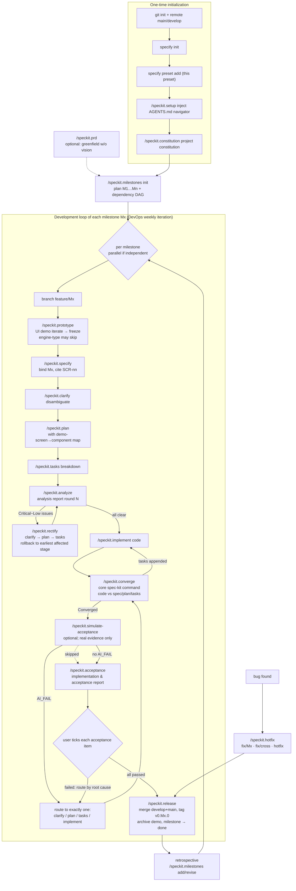

# Milestone-Driven Development Workflow

**Plan milestones first, then run each through a full "UI Demo → Specify → Plan → Tasks → Analyze/Rectify → Implement → Converge → optional Simulate Acceptance → Acceptance → Release" loop.**

English | [简体中文](README.zh-CN.md)

A [spec-kit](https://github.com/github/spec-kit) preset that extends spec-driven development (SDD) into a **milestone-driven** end-to-end workflow. Plan milestones up front, then drive every milestone through "UI Demo → Specify → Plan → Tasks → Analyze/Rectify → Implement → Converge → optional Simulate Acceptance → Acceptance → Release", with DevOps-style iteration and dual-path bug fixes.

| | |
| --- | --- |
| Version | 1.6.0 ([CHANGELOG](CHANGELOG.md)) |
| Requires | spec-kit CLI >= 1.0.9 |
| License | [MIT](LICENSE) |

## What It Solves

Stock spec-kit covers "how one feature goes from spec to code" — but not:

- **How a whole system ships in stages** — this preset plans it via a milestones file (one milestone = one module = one specify = one feature/Mx branch), with a dependency DAG enabling parallel development.
- **Ambiguity hiding in the UI** — a UI demo is iterated and frozen *before* specify (a visual prototype is the most efficient disambiguation tool).
- **What to do after analysis finds problems** - analysis reports persist per round as evidence-backed issue cards with stable keys, impact, a concrete artifact change, validation criteria, and exactly one repair route. Rectify then runs clarify → plan → tasks in order and rolls back to the earliest affected stage when downstream edits break an upstream artifact.
- **Whether the code actually implements the approved intent** - after implementation, the core `/speckit.converge` command compares current code with spec, plan, tasks, and constitution. Appended tasks return to implement; no actionable gap reports `Converged`.
- **Whether acceptance can be prechecked safely** - the optional `/speckit.simulate-acceptance` records real command evidence and classifies each item as `AI_PASS`, `AI_FAIL`, `HUMAN_REQUIRED`, or `BLOCKED`. A missing or stale baseline falls back to full manual acceptance.
- **When a milestone counts as "done"** — the Implementation & Acceptance Report includes per-item manual acceptance guides; merge and release only after the user ticks every box.
- **Users not knowing which command comes next** — at setup time, a workflow-navigator block is injected into AGENTS.md (speckit.setup), so the agent ends every reply with the current stage and available required/optional actions; removable at any time.
- **Thinking that needs pressure-testing mid-flow** — two anytime side skills: `/speckit.grill` (a relentless design-tree interview) and `/speckit.brainstorm` (dialogue-first design doc with a builder check and a browser visual companion). Usable at any stage; their conclusions always sink into the artifact of the stage they were invoked in, never into stray side files.

## Installation

Inside an initialized spec-kit project (after `specify init`):

~~~bash
# Option A: install from the GitHub release archive (recommended)
specify preset add --from https://github.com/sigentech/speckit-preset-milestone-driven-dev/archive/refs/tags/v1.6.0.zip

# Option B: install from a local directory (development)
specify preset add --dev /path/to/speckit-preset-milestone-driven-dev

# Verify
specify preset info milestone-driven-dev
specify preset resolve milestones-template
~~~

## When to Use / When Not

**Good fit**: long-term iterative development of mid-to-large systems; solo developers or small teams working with AI coding; projects that need every stage verifiable and traceable.
**Not for**: one-off scripts or toy projects (process overhead outweighs the gain); purely exploratory prototypes (consider running only this preset's prototype stage).

## Quick Start (New Project)

~~~bash
# 1. Git & remote: main = release branch, develop = integration branch
git init && git add -A && git commit -m "chore: initial commit"
git branch -M main
git remote add origin <your-remote-repo-url>
git push -u origin main
git checkout -b develop && git push -u origin develop

# 2. Initialize spec-kit and install this preset
specify init --here --integration codex      # or claude / copilot, etc.
specify preset add --from https://github.com/sigentech/speckit-preset-milestone-driven-dev/archive/refs/tags/v1.6.0.zip

# 3. Inject the AGENTS.md workflow navigator (agent suggests next steps after every reply)
/speckit.setup

# 4. Project constitution: pin the tech-stack floor, quality gates, branch discipline
/speckit.constitution

# 5. Milestone planning (feature vision → M1…Mn + dependency DAG)
/speckit.milestones init
#   Greenfield projects without a vision source may run /speckit.prd first

# 6. Per-milestone development loop (see flowchart), starting from M1
/speckit.prototype gen M1
~~~

## Full Flowchart (Which Command at Which Stage)

**Three human actions that cannot be waived**: milestone-plan confirmation, ticking each manual acceptance item, and final confirmation before release. All other steps default to AUTO (agent executes + gate checks), with human intervention possible on any artifact at any step.

## The Milestone Loop (Twelve Steps per Mx)

| Step | Command | Artifact / Action | Gate |
| --- | --- | --- | --- |
| 1 | (branch) | `git checkout -b feature/Mx` (handled inside prototype/specify) | cut from develop |
| 2 | speckit.prototype | `specs/NNN-mX-slug/prototype/` (HTML demo + prototype.md) | inherits UX baseline; **user-confirmed freeze** after iteration; engine-type may skip |
| 3 | speckit.specify | `specs/NNN-mX-slug/spec.md` (UI-contract section citing SCR-nn) | demo frozen/degraded; milestone bound; scope within bounds |
| 4 | speckit.clarify | spec.md disambiguation | zero vague wording |
| 5 | speckit.plan | plan.md (with demo-screen to component map) | constitution-compliant; no interactions the demo lacks |
| 6 | speckit.tasks | tasks.md | spec, plan, and tasks aligned |
| 7 | speckit.analyze | analysis report at `./.auxiliary/docs/specs-analysis-repo/[spec-dir]-analysis.md` | four severity sections, issue cards, one repair route per issue |
| 8 | speckit.rectify | updated spec/plan/tasks plus phased elimination log | clarify → plan → tasks clears Critical~Low; regressions roll back |
| 9 | speckit.converge | core spec-kit convergence result | appended tasks return to implement; acceptance waits for `Converged` |
| 10 | speckit.simulate-acceptance (optional) | `specs/NNN-mX-slug/acceptance-simulation.md` | real evidence only; `AI_FAIL` blocks acceptance; stale baseline falls back to manual |
| 11 | speckit.acceptance | `specs/NNN-mX-slug/implementation-report.md` and push | current code is `Converged`; **user ticks every remaining item** |
| 12 | speckit.release | merge develop+main, tag `v0.Mx.0`, push, archive demo, milestone done | every acceptance item "passed" |

**Milestone sizing principles**: one milestone delivers one module; independently acceptable; size S ≤1 week / M 1~3 weeks (L requires a written justification); foundations before upper layers. Detail fields include priority (MoSCoW) and user journey (3~7 steps — prototype screen lists and acceptance items derive from it).

**Parallel rule**: mutually independent milestones (same parallel group) may open feature branches simultaneously; merges follow DAG topological order; active feature branches sync once after each new merge into develop.

## Key Rules

**UI demo stage** (speckit.prototype): sits after milestones and before specify; demos use lightweight HTML + mock data (decoupled from the real stack); mid-development UI changes are tiered — visual tweaks change directly (logged in the report) / interaction changes update the demo first, then route through clarify→plan→tasks (changing code first is a violation) / scope changes go to milestones for adjudication; at release, real UI screenshots flow back and the demo is archived as "superseded by implementation".

**Analysis reports and phased rectification**: reports default to `./.auxiliary/docs/specs-analysis-repo/[spec-dir]-analysis.md`; keep one report per spec, append each round, and never rewrite history. Every issue is a detailed card with an ID, stable key, evidence, impact, exact artifact section to change, validation criterion, and exactly one repair route: `speckit.clarify`, `speckit.plan`, or `speckit.tasks`. Severity is Critical (blocking) / High (rework) / Medium (risk) / Low (polish), with all four levels cleared. Rectify runs clarify → plan → tasks and returns to the earliest affected stage whenever a downstream edit creates an upstream issue. The same stable key unresolved for two rounds halts the loop for user adjudication.

**Converge after implementation**: `/speckit.converge` is the core spec-kit command and is not bundled or overridden by this preset. After all Agent-executable tasks are complete, implement hands off to converge. If it appends tasks, return to implement and converge again; only a `Converged` result may proceed to acceptance.

**Optional acceptance simulation**: after `Converged`, `/speckit.simulate-acceptance` may precheck items that can be verified with real commands and evidence. Every item is exactly one of `AI_PASS`, `AI_FAIL`, `HUMAN_REQUIRED`, or `BLOCKED`. Test output, exit codes, screenshots, external state, and human experience must never be fabricated. The simulation records commit and artifact fingerprints plus a clean-worktree baseline; any missing, malformed, or stale baseline falls back to full manual acceptance. `AI_FAIL` blocks formal acceptance.

**DevOps iteration path**: the milestones file is the "planning board" (add/revise + change log); enhancements to a done milestone always become a new milestone — history is never rewritten; plan the next round after each retrospective. Bypassing milestones to run specify directly is forbidden.

**Dual-path bug fixing**: in development → fix directly on feature/Mx; released single-milestone → `fix/Mx-slug` (→develop+main); cross-milestone/shared-layer → `fix/cross-slug` (→develop+main+all active feature branches; no new milestone until propagation completes); urgent on main → `hotfix/slug`. Iron rules: write the regression test first; minimal change; if a spec error is exposed, feed it back through the rectify routing.

**Implementation and acceptance report**: after converge is clean, formal acceptance generates `implementation-report.md` (implementation overview / automated verification / key decisions / optional simulation status and evidence / **per-item manual acceptance guides** / artifact locator). The report is committed and pushed; release requires every acceptance item "passed".

**Anytime deep-dive skills** (speckit.grill / speckit.brainstorm): side skills callable at any stage when a decision needs pressure-testing or open-ended exploration. Grill runs a design-tree interview in numbered rounds (agent digs up the facts, the user owns the decisions) until nothing is silently assumed. Brainstorm talks through what and why before anything is built, lays out approaches, writes a design doc (full version gets a blind builder check by a fresh subagent; a browser visual companion serves mockups when seeing beats reading), and builds nothing until the doc is approved. Both record their conclusions into the current stage's artifact — milestones change log, prototype iteration log, spec clarifications, plan decisions, or rectify routing — and never into stray side files; brainstorm's design doc lands in the current spec's `design/` folder. **Invoked before constitution/PRD/milestones exist** (right after preset setup), outputs are registered in `docs/explore/` with a frontmatter status machine (`pending-absorb`/`absorbed`): speckit.prd and speckit.milestones init automatically scan and absorb them as vision material, then write back the absorption target — early exploration never gets lost between stages and stays traceable. The navigator block surfaces the pending-absorb count every reply.

## Configuration

| Setting | Where | Default |
| --- | --- | --- |
| Feature-vision source | given at `speckit.milestones init` (`--vision <path>` or asked) | asked; if missing, generate a PRD via speckit.prd |
| UX baseline path | `.specify/memory/milestones.md` §1 `ux_baseline` | `docs/ux-baseline/` (created from ux-baseline-template) |
| Analysis-report directory | reconfigurable in the constitution | `./.auxiliary/docs/specs-analysis-repo/` |
| Early-exploration registry | fixed convention (grill/brainstorm write; prd/milestones absorb) | `docs/explore/` |
| AGENTS.md navigator block | `/speckit.setup` (inject/remove/status) | project-root `AGENTS.md`, marker-wrapped idempotent injection |

When upgrading from v1.5.0, the default analysis directory changed. If a project constitution pins the previous default, update that configuration and move existing reports into `.auxiliary/docs/specs-analysis-repo/` so round history remains continuous.

## File Inventory

~~~text
├── preset.yml                      preset manifest (schema 1.0)
├── README.md / README.zh-CN.md / LICENSE / CHANGELOG.md
├── commands/                       15 commands
│   ├── speckit.setup.md            AGENTS.md navigator injection (inject/remove/status)
│   ├── speckit.milestones.md       milestone planning (init/add/revise/status)
│   ├── speckit.prototype.md        UI demo first (gen/freeze/skip/status)
│   ├── speckit.prd.md              PRD (optional; enable when vision is missing)
│   ├── speckit.specify.md          (override) milestone binding + branch + UI contract
│   ├── speckit.plan.md             (override) demo-screen→component map
│   ├── speckit.analyze.md          (override) persisted reports + four severity grades
│   ├── speckit.rectify.md          phased issue elimination (clarify→plan→tasks) with rollback
│   ├── speckit.implement.md        (override) gates + hand-off to core converge
│   ├── speckit.simulate-acceptance.md  optional evidence-backed pre-acceptance
│   ├── speckit.acceptance.md       implementation & acceptance report
│   ├── speckit.release.md          merge & release (feature/Mx→develop→main)
│   ├── speckit.hotfix.md           dual-path bug fixing
│   ├── speckit.grill.md            (side) relentless design-tree interview, any stage
│   └── speckit.brainstorm.md       (side) dialogue-first brainstorm → approved design doc
└── templates/                      11 templates
    ├── milestones-template.md      milestone plan (priority/user journey/dependency DAG)
    ├── prototype-template.md       UI demo checklist (SCR-nn screen list)
    ├── ux-baseline-template.md     UX design baseline (design tokens/component conventions)
    ├── agents-reminder-template.md AGENTS.md navigator block (state-detection table)
    ├── analysis-report-template.md analysis report (appended per round)
    ├── acceptance-simulation-template.md  optional pre-acceptance evidence and manual guide
    ├── implementation-report-template.md  implementation & acceptance report
    ├── prd-template.md             PRD (optional)
    ├── explore-note-template.md    early-exploration note (frontmatter absorb-state machine)
    └── brainstorming/              speckit.brainstorm companions
        ├── builder-check-prompt.md builder blind-review prompt for design docs
        ├── visual-companion.md     browser visual-companion guide
        └── scripts/                companion server (server.cjs / helper.js / frame-template.html / start / stop)
~~~

`/speckit.converge` is supplied by spec-kit core and is intentionally absent from this preset's file inventory.

## Design Lineage

This preset was originally developed as SPEC-003 of the Research-reports-writing-guru project (governing the system development of an "intelligent research-report writing system"); it became a standalone, general-purpose preset in v1.2.0. Its form follows [adaumann/speckit-preset-fiction-book-writing](https://github.com/adaumann/speckit-preset-fiction-book-writing); its methodological core is milestone-driven planning + DevOps iteration + spec-kit spec-driven development. The two side skills are ported from mattpocock's grilling / grill-me skills and obra's superpowers brainstorming skill, adapted so their outputs land in the artifacts of the workflow stage they are invoked in.

## License

[MIT](LICENSE)
