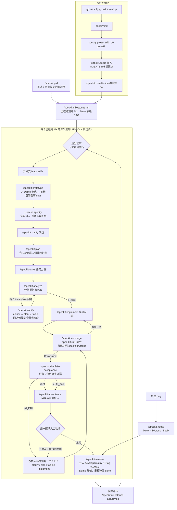

# Milestone-Driven Development Workflow（里程碑驱动开发工作流）

**先规划里程碑，再让每个里程碑走"UI Demo → 规格 → 计划 → 任务 → 分析消除 → 实现 → 收敛 → 可选模拟验收 → 正式验收 → 发布"的完整循环。**

[English](README.md) | 简体中文

一套 [spec-kit](https://github.com/github/spec-kit) preset：把 spec-kit 的规约驱动开发（SDD）扩展为**里程碑驱动**的完整工作流。先规划里程碑，再让每个里程碑走"UI Demo → 规格 → 计划 → 任务 → 分析消除 → 实现 → 收敛 → 可选模拟验收 → 正式验收 → 发布"的完整循环，配 DevOps 式迭代与双路径 bug 修复。

| | |
| --- | --- |
| 版本 | 1.6.0（[CHANGELOG](CHANGELOG.md)） |
| 要求 | spec-kit CLI >= 1.0.9 |
| 许可证 | [MIT](LICENSE) |

## 它解决什么

原生 spec-kit 管"一个功能怎么从规格到代码"，但不管：

- **整个系统分几步交付**——本 preset 以里程碑文件（一个里程碑=一个功能模块=一个 specify=一个 feature/Mx 分支）统一规划，依赖 DAG 支持并行开发
- **需求在界面上藏污纳垢**——specify 之前先做 UI Demo 并迭代冻结（视觉原型是最高效的消歧工具）
- **分析发现问题之后怎么办**——分析报告按轮次落盘，每条问题都带稳定问题键、证据、影响、具体产物改法、验证判据和唯一修复入口；rectify 按 clarify → plan → tasks 固定顺序消除，下游改动破坏上游产物时回退到最早受影响阶段
- **代码是否真的实现了已批准意图**——实现后由核心 `/speckit.converge` 对照 spec、plan、tasks 与 constitution；追加任务则回到 implement，无可执行缺口才报告 `Converged`
- **验收能否安全预检**——可选 `/speckit.simulate-acceptance` 记录真实命令证据，并逐项使用 `AI_PASS`、`AI_FAIL`、`HUMAN_REQUIRED`、`BLOCKED` 四态；baseline 缺失或过期时退回全人工验收
- **每个里程碑怎么算"成了"**——《实现与验收报告》含逐项人工验收操作指南，用户打勾后才允许合流发布
- **用户不知道下一步该敲哪条命令**——初始化时向 AGENTS.md 注入"工作流领航提醒块"（speckit.setup），Agent 每次回复末尾自动提示当前环节与主线/可选操作，可随时 remove
- **想法在流程中途需要压力测试**——两个任意环节可用的旁路技能：`/speckit.grill`（设计树拷问式深挖）与 `/speckit.brainstorm`（对话先行、设计文档经建造者盲审、可选浏览器可视化伴侣）。结论一律沉淀到调用时所在环节的正式产物，不产生游离文件

## 安装

在一个已初始化的 spec-kit 项目中（`specify init` 之后）：

~~~bash
# 方式 A：从 GitHub 发布包安装（推荐）
specify preset add --from https://github.com/sigentech/speckit-preset-milestone-driven-dev/archive/refs/tags/v1.6.0.zip

# 方式 B：本地目录安装（开发/调试）
specify preset add --dev /path/to/speckit-preset-milestone-driven-dev

# 验证
specify preset info milestone-driven-dev
specify preset resolve milestones-template
~~~

## 何时用 / 何时不用

**适合**：中大型系统的长期迭代开发；单人或小团队 + AI Coding；需要每个阶段都可验收、可追溯的项目。
**不适合**：一次性脚本/玩具项目（流程开销大于收益）；纯探索性原型（建议只用本 preset 的 prototype 阶段单跑）。

## 快速开始（新项目）

~~~bash
# 1. Git 与远程：main=发布分支，develop=集成开发分支
git init && git add -A && git commit -m "chore: initial commit"
git branch -M main
git remote add origin <你的远程仓库地址>
git push -u origin main
git checkout -b develop && git push -u origin develop

# 2. 初始化 spec-kit 并安装本 preset
specify init --here --integration codex      # 或 claude / copilot 等
specify preset add --from https://github.com/sigentech/speckit-preset-milestone-driven-dev/archive/refs/tags/v1.6.0.zip

# 3. 注入 AGENTS.md 工作流领航提醒（Agent 每次回复末尾提示下一步）
/speckit.setup

# 4. 项目宪法：固化技术栈底线、质量门禁、分支纪律
/speckit.constitution

# 5. 里程碑规划（功能愿景 → M1…Mn + 依赖 DAG）
/speckit.milestones init
#   愿景来源缺失的全新项目可先用 /speckit.prd 生成 PRD

# 6. 逐里程碑开发循环（见下方流程图），从 M1 开始
/speckit.prototype gen M1
~~~

## 全流程图（什么环节用哪个指令）

**三个不可豁免的人工动作**：里程碑规划确认、人工验收逐项打勾、release 前的最终确认。其余步骤默认 AUTO（Agent 执行+门禁校验），每步均可人工介入修改产物。

## 里程碑开发循环（每个 Mx 的十二步）

| 步 | 命令 | 产物/动作 | 门禁 |
| --- | --- | --- | --- |
| | （分支） | `git checkout -b feature/Mx`（prototype/specify 内建处理） | 从 develop 切出 |
| 1 | speckit.prototype | `specs/NNN-mX-短名/prototype/`（HTML Demo + prototype.md） | 继承 UX 基线；迭代后**用户确认冻结**；引擎型可 skip |
| 2 | speckit.specify | `specs/NNN-mX-短名/spec.md`（含 UI 契约节引 SCR-nn） | Demo 已冻结/降级；关联里程碑；范围不越界 |
| 3 | speckit.clarify | spec.md 消歧 | 模糊词清零 |
| 4 | speckit.plan | plan.md（含 Demo屏到组件映射表） | 宪法合规；无 Demo 没有的交互 |
| 5 | speckit.tasks | tasks.md | spec、plan、tasks 对齐 |
| 6 | speckit.analyze | 分析报告：`[analysis_report_dir]/[spec-dir]-analysis.md` | 四级分区、完整问题卡、每条问题唯一修复入口 |
| 7 | speckit.rectify | 更新 spec/plan/tasks + 阶段化消除记录 | clarify → plan → tasks 清空 Critical~Low；上游回归立即回退 |
| 8 | speckit.implement | 源码、测试与分批 `feat(Mx): …` 提交 | 全部 Agent 可执行任务完成；交给 converge 做代码到意图闭合 |
| 9 | speckit.converge | spec-kit 核心收敛结果 | 追加任务则回到 implement；循环 implement → converge 直到 `Converged` |
| 10 | speckit.simulate-acceptance（可选） | `specs/NNN-mX-短名/acceptance-simulation.md` | 来源键与判据指纹均认证；`AI_FAIL` 阻止验收；baseline 过期退回全人工 |
| 11 | speckit.acceptance | `specs/NNN-mX-短名/implementation-report.md` 并推送远程 | 代码已 `Converged`；验证前后快照一致；**用户逐项确认剩余人工项** |
| 12 | speckit.release | 并入 develop+main、tag `v0.Mx.0`、推送、Demo 归档、milestones 置 done | 验收项全"通过" |

**里程碑密度原则**：一个里程碑实现一个功能模块；独立可验收；规模 S ≤1 周 / M 1~3 周（L 须书面说明）；先地基后上层。明细字段含优先级（MoSCoW）与用户旅程（3~7 步，prototype 屏清单与验收项由此拆解）。

**并行规则**：无相互依赖的里程碑（同并行组）可同时开 feature 分支；合并按 DAG 拓扑序；活跃 feature 分支在 develop 有新合并后同步一次。

## 关键规则

**UI Demo 环节**（speckit.prototype）：位于 milestones 之后、specify 之前；Demo 用轻量 HTML + mock 数据（不绑定真实栈）；开发期 UI 变更分级——视觉微调直接改（报告留痕）/ 交互变更先改 Demo 再走 clarify→plan→tasks（先改代码视为违例）/ 范围变更走 milestones 裁决；release 时真实界面截图回灌，Demo 标"已被实现取代"归档。

**分析报告与分阶段问题消除**：报告目录由 constitution 中唯一一行 `analysis_report_dir: <path>` 决定；缺失时使用默认 `./.auxiliary/docs/specs-analysis-repo/`。文件名固定为 `[spec-dir]-analysis.md`；重复、空或不可解析的登记会停止流程，不得猜测。每 spec 一份、按轮次追加、不重写历史。每条问题都是完整问题卡，至少含问题 ID、稳定问题键、证据、影响、要修改的产物章节、验证判据，以及唯一修复入口：`speckit.clarify`、`speckit.plan` 或 `speckit.tasks`。严重级为 Critical（阻塞）/ High（返工）/ Medium（风险）/ Low（打磨），四级全部清零；rectify 按 clarify → plan → tasks 执行，下游修改引入上游问题时回到最早受影响阶段。同一稳定问题键连续两轮未消除时停止自动循环，交用户裁决。

**实现后收敛**：`/speckit.converge` 是 spec-kit 核心命令，本 preset 不捆绑、不覆盖。全部 Agent 可执行任务完成后，implement 交接给 converge；若追加任务则回到 implement，完成后再 converge，只有报告 `Converged` 才允许进入验收。

**可选验收模拟**：`Converged` 后可选运行 `/speckit.simulate-acceptance`，对能用真实命令与证据验证的项目做预验收。每项状态只能是 `AI_PASS`、`AI_FAIL`、`HUMAN_REQUIRED`、`BLOCKED` 之一。不得伪造测试输出、退出码、截图、外部系统状态或真人体验结论。每个来源行记录稳定键与 `判据指纹: sha256:<hex>`：当前判据经 Unicode NFC 规范化、行尾统一为 LF、去掉首尾空白、内部连续空白折叠为一个空格后，以 UTF-8 计算 SHA-256。正式验收会独立提取并计算当前判据指纹；缺失、被替换、无法解析或指纹不匹配会使整个模拟失效并退回全人工验收。模拟还记录 commit、产物指纹与工作区清洁 baseline；缺失、格式错误或过期的 baseline 同样退回全人工验收。只要存在可见的 `AI_FAIL`，即使 baseline 已过期，也阻止验收。

**DevOps 迭代路径**：里程碑文件即"计划板"（add/revise + 变更日志）；已 done 里程碑的功能增强一律 add 新里程碑，不改历史；回顾评审后规划下一轮。禁止绕过里程碑直接 specify。

**Bug 修复双路径**：开发中→直接在 feature/Mx 修；已发布单里程碑→`fix/Mx-短名`（→develop+main）；跨里程碑/共享层→`fix/cross-短名`（→develop+main+全部活跃 feature，未传播完不得开新里程碑）；main 紧急→`hotfix/短名`。铁律：先写回归测试再修；最小改动；暴露规格错误时按 rectify 路由回补规格。

**实现与验收报告**：converge 清零后由正式验收生成 `implementation-report.md`（实现概述/自动化验证/技术决策/可选模拟状态与证据/**逐项人工验收操作指南**/产物速查）；报告随 docs 提交并推送远程；验收项全"通过"方可 release。

**任意环节的深挖技能**（speckit.grill / speckit.brainstorm）：流程任何环节可调用的旁路技能。grill 以设计树逐轮拷问（查事实归 Agent，做决定归用户），直到没有隐含假设；brainstorm 先对话聊清要什么/为什么，再摆做法、写设计文档（完整版经全新子代理盲审；看比读更直观时可用浏览器可视化伴侣展示稿图），文档批准前不动工。两者的结论一律沉淀到当前环节产物——milestones 变更日志、prototype 迭代记录、spec 澄清、plan 决策、rectify 路由——不另起游离文件；brainstorm 的设计文档落当前 spec 的 `design/` 目录，获批后路由回当前环节主线命令。**在宪法/PRD/里程碑规划之前调用**（preset 装完就用）时，产出统一登记到 `docs/explore/`（带 frontmatter 状态机 `pending-absorb`/`absorbed`）：speckit.prd 与 speckit.milestones init 会自动扫描、通读并吸收为愿景素材，吸收后回写去向——前期深挖的结论不会随换环节失联，且全程可溯源；领航提醒块会在每次回复里提示待吸收数量。

## 配置项

| 配置 | 位置 | 默认 |
| --- | --- | --- |
| 功能愿景来源 | `speckit.milestones init` 时指定（`--vision <路径>` 或询问） | 询问；缺失可先用 speckit.prd 生成 |
| UX 基线路径 | `.specify/memory/milestones.md` §一 `ux_baseline` | `docs/ux-baseline/`（用 ux-baseline-template 建立） |
| 分析报告输出目录 | constitution 唯一一行 `analysis_report_dir: <path>`；重复、空或不可解析即停止 | `./.auxiliary/docs/specs-analysis-repo/`；文件名 `[spec-dir]-analysis.md` |
| 前期探索登记处 | 固定约定（grill/brainstorm 写入，prd/milestones 吸收） | `docs/explore/` |
| AGENTS.md 提醒块 | `/speckit.setup`（inject/remove/status） | 项目根 `AGENTS.md`，标记块幂等注入 |

从 v1.5.0 升级时，分析报告默认目录已变更。若项目 constitution 固定了旧默认目录，请同步修改 `analysis_report_dir: <path>`，并把既有报告迁入所选目录，保持轮次历史连续。

## 文件清单

~~~text
├── preset.yml                      preset 清单（schema 1.0）
├── README.md（English）/ README.zh-CN.md / LICENSE / CHANGELOG.md
├── commands/                       15 个命令
│   ├── speckit.setup.md            AGENTS.md 提醒块注入（inject/remove/status）
│   ├── speckit.milestones.md       里程碑规划（init/add/revise/status）
│   ├── speckit.prototype.md        UI Demo 先行（gen/freeze/skip/status）
│   ├── speckit.prd.md              PRD（可选，愿景缺失时启用）
│   ├── speckit.specify.md          （覆盖）关联里程碑+分支+UI 契约
│   ├── speckit.plan.md             （覆盖）Demo屏→组件映射表
│   ├── speckit.analyze.md          （覆盖）分析报告落盘+四级严重度
│   ├── speckit.rectify.md          分阶段问题消除（clarify→plan→tasks）与上游回退
│   ├── speckit.implement.md        （覆盖）门禁+收尾接核心 converge
│   ├── speckit.simulate-acceptance.md  可选、证据驱动的预验收
│   ├── speckit.acceptance.md       实现与验收报告
│   ├── speckit.release.md          合流发布（feature/Mx→develop→main）
│   ├── speckit.hotfix.md           bug 修复双路径
│   ├── speckit.grill.md            （旁路）设计树拷问式深挖，任意环节可用
│   └── speckit.brainstorm.md       （旁路）对话式头脑风暴 → 批准后路由回主线
└── templates/                      11 个模板
    ├── milestones-template.md      里程碑规划（优先级/用户旅程/依赖 DAG）
    ├── prototype-template.md       UI Demo 说明清单（SCR-nn 屏清单）
    ├── ux-baseline-template.md     UX 设计基线（设计令牌/组件约定）
    ├── agents-reminder-template.md AGENTS.md 领航提醒块（状态检测表）
    ├── analysis-report-template.md 分析报告（轮次追加）
    ├── acceptance-simulation-template.md  可选预验收证据与人工指南
    ├── implementation-report-template.md  实现与验收报告
    ├── prd-template.md             PRD（可选）
    ├── explore-note-template.md    前期探索登记文件（frontmatter 吸收状态机）
    └── brainstorming/              speckit.brainstorm 配套资源
        ├── builder-check-prompt.md 设计文档建造者盲审提示词
        ├── visual-companion.md     浏览器可视化伴侣指南
        └── scripts/                伴侣服务脚本（server.cjs / helper.js / frame-template.html / start / stop）
~~~

`/speckit.converge` 由 spec-kit 核心提供，因此有意不出现在本 preset 的文件清单中。

## 设计渊源

本 preset 最初作为 Research-reports-writing-guru 项目的 SPEC-003 开发（用于规范"研究报告智能撰写系统"的系统开发），v1.2.0 起解耦为独立通用 preset。形式范式参考 [adaumann/speckit-preset-fiction-book-writing](https://github.com/adaumann/speckit-preset-fiction-book-writing)；方法论内核为里程碑驱动 + DevOps 迭代 + spec-kit 规约驱动开发。两个旁路技能分别移植自 mattpocock 的 grilling / grill-me 技能与 obra 的 superpowers brainstorming 技能，均已适配为"产出落入调用时所在环节的产物"。

## 许可证

[MIT](LICENSE)
