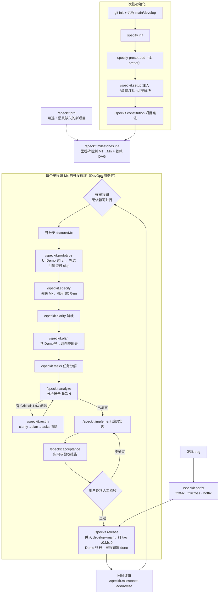

# Milestone-Driven Development Workflow（里程碑驱动开发工作流）

**先规划里程碑，再让每个里程碑走"UI Demo → 规格 → 计划 → 任务 → 分析消除 → 实现 → 验收 → 发布"的完整循环。**

[English](README.md) | 简体中文

一套 [spec-kit](https://github.com/github/spec-kit) preset：把 spec-kit 的规约驱动开发（SDD）扩展为**里程碑驱动**的完整工作流——先规划里程碑，再让每个里程碑走"UI Demo → 规格 → 计划 → 任务 → 分析消除 → 实现 → 验收 → 发布"的完整循环，配 DevOps 式迭代与双路径 bug 修复。

| | |
| --- | --- |
| 版本 | 1.3.1（[CHANGELOG](CHANGELOG.md)） |
| 要求 | spec-kit CLI >= 0.5.0（已在 v0.14.4 验证） |
| 许可证 | [MIT](LICENSE) |

## 它解决什么

原生 spec-kit 管"一个功能怎么从规格到代码"，但不管：

- **整个系统分几步交付**——本 preset 以里程碑文件（一个里程碑=一个功能模块=一个 specify=一个 feature/Mx 分支）统一规划，依赖 DAG 支持并行开发
- **需求在界面上藏污纳垢**——specify 之前先做 UI Demo 并迭代冻结（视觉原型是最高效的消歧工具）
- **分析发现问题之后怎么办**——分析报告按轮次落盘，配套 clarify→plan→tasks 消除回路，Critical~Low 全部立即消除、闭环验证
- **每个里程碑怎么算"成了"**——《实现与验收报告》含逐项人工验收操作指南，用户打勾后才允许合流发布
- **用户不知道下一步该敲哪条命令**——初始化时向 AGENTS.md 注入"工作流领航提醒块"（speckit.setup），Agent 每次回复末尾自动提示当前环节与主线/可选操作，可随时 remove

## 安装

在一个已初始化的 spec-kit 项目中（`specify init` 之后）：

~~~bash
# 方式 A：从 GitHub 发布包安装（推荐）
specify preset add --from https://github.com/sigentech/speckit-preset-milestone-driven-dev/archive/refs/tags/v1.3.1.zip

# 方式 B：本地目录安装（开发/调试）
specify preset add --dev /path/to/speckit-preset-milestone-driven-dev

# 验证
specify preset info milestone-driven-dev
specify preset resolve milestones-template
~~~

specify preset resolve milestones-template
~~~

## 何时用 / 何时不用

**适合**：中大型系统的长期迭代开发；单人或小团队 + AI Coding；需要每个阶段都可验收、可追溯的项目。
**不适合**：一次性脚本/玩具项目（流程开销大于收益）；纯探索性原型（建议只用本 preset 的 prototype 阶段单跑）。

## 快速开始（新项目）

~~~bash
# 1. Git 与远程：main=发布分支，develop=集成开发分支
git init && git add -A && git commit -m "chore: initial commit"
git branch -M main
git remote add origin <你的远程仓库地址>
git push -u origin main
git checkout -b develop && git push -u origin develop

# 2. 初始化 spec-kit 并安装本 preset
specify init --here --integration codex      # 或 claude / copilot 等
specify preset add --from https://github.com/sigentech/speckit-preset-milestone-driven-dev/archive/refs/tags/v1.3.1.zip

# 3. 注入 AGENTS.md 工作流领航提醒（Agent 每次回复末尾提示下一步）
/speckit.setup

# 4. 项目宪法：固化技术栈底线、质量门禁、分支纪律
/speckit.constitution

# 5. 里程碑规划（功能愿景 → M1…Mn + 依赖 DAG）
/speckit.milestones init
#   愿景来源缺失的全新项目可先用 /speckit.prd 生成 PRD

# 6. 逐里程碑开发循环（见下方流程图），从 M1 开始
/speckit.prototype gen M1
~~~

## 全流程图（什么环节用哪个指令）

**三个不可豁免的人工动作**：里程碑规划确认、人工验收逐项打勾、release 前的最终确认。其余步骤默认 AUTO（Agent 执行+门禁校验），每步均可人工介入修改产物。

**三个不可豁免的人工动作**：里程碑规划确认、人工验收逐项打勾、release 前的最终确认。其余步骤默认 AUTO（Agent 执行+门禁校验），每步均可人工介入修改产物。

## 里程碑开发循环（每个 Mx 的十步）

| 步 | 命令 | 产物/动作 | 门禁 |
| --- | --- | --- | --- |
① | （分支） | `git checkout -b feature/Mx`（prototype/specify 内建处理） | 从 develop 切出 |
② | speckit.prototype | `specs/NNN-mX-短名/prototype/`（HTML Demo + prototype.md） | 继承 UX 基线；迭代后**用户确认冻结**；引擎型可 skip |
③ | speckit.specify | `specs/NNN-mX-短名/spec.md`（含 UI 契约节引 SCR-nn） | Demo 已冻结/降级；关联里程碑；范围不越界 |
④ | speckit.clarify | spec.md 消歧 | 模糊词清零 |
⑤ | speckit.plan | plan.md（含 Demo屏→组件映射表） | 宪法合规；无 Demo 没有的交互 |
⑥ | speckit.tasks | tasks.md | spec↔plan↔tasks 对齐 |
⑦ | speckit.analyze | 分析报告（轮次 N，见"配置项"） | 分级落盘 |
⑦' | speckit.rectify | 更新 spec/plan/tasks + 报告消除记录 | Critical~Low 全消，防新问题 |
⑧ | speckit.implement | 源码+测试，分批提交 `feat(Mx): …` | 报告清零方可进入 |
⑨ | speckit.acceptance | `specs/NNN-mX-短名/implementation-report.md` → 推送远程 | 自动化验证全过；**用户逐项人工验收** |
⑩ | speckit.release | 并入 develop+main、tag `v0.Mx.0`、推送、Demo 归档、milestones 置 done | 验收项全"通过" |

**里程碑密度原则**：一个里程碑实现一个功能模块；独立可验收；规模 S ≤1 周 / M 1~3 周（L 须书面说明）；先地基后上层。明细字段含优先级（MoSCoW）与用户旅程（3~7 步，prototype 屏清单与验收项由此拆解）。

**并行规则**：无相互依赖的里程碑（同并行组）可同时开 feature 分支；合并按 DAG 拓扑序；活跃 feature 分支在 develop 有新合并后同步一次。

## 关键规则

**UI Demo 环节**（speckit.prototype）：位于 milestones 之后、specify 之前；Demo 用轻量 HTML + mock 数据（不绑定真实栈）；开发期 UI 变更分级——视觉微调直接改（报告留痕）/ 交互变更先改 Demo 再走 clarify→plan→tasks（先改代码视为违例）/ 范围变更走 milestones 裁决；release 时真实界面截图回灌，Demo 标"已被实现取代"归档。

**分析报告与问题消除**：报告默认存 `./.prepare/docs/specs-analysis-repo/[spec目录名]-analysis.md`，每 spec 一份、按轮次追加、只增不删；问题分 Critical（阻塞）/ High（返工）/ Medium（风险）/ Low（打磨），全部立即消除（仅 Low 可经用户显式裁决豁免）；消除路由——规格层→clarify、方案层→plan、任务层→tasks；同一问题两轮未消除→停下请用户裁决。

**DevOps 迭代路径**：里程碑文件即"计划板"（add/revise + 变更日志）；已 done 里程碑的功能增强一律 add 新里程碑，不改历史；回顾评审后规划下一轮。禁止绕过里程碑直接 specify。

**Bug 修复双路径**：开发中→直接在 feature/Mx 修；已发布单里程碑→`fix/Mx-短名`（→develop+main）；跨里程碑/共享层→`fix/cross-短名`（→develop+main+全部活跃 feature，未传播完不得开新里程碑）；main 紧急→`hotfix/短名`。铁律：先写回归测试再修；最小改动；暴露规格错误时按 rectify 路由回补规格。

**实现与验收报告**：tasks 全部 Agent 可执行任务完成后生成 `implementation-report.md`（实现概述/自动化验证/技术决策/**逐项人工验收操作指南**/产物速查）；报告随 docs 提交并推送远程；验收项全"通过"方可 release。

## 配置项

| 配置 | 位置 | 默认 |
| --- | --- | --- |
| 功能愿景来源 | `speckit.milestones init` 时指定（`--vision <路径>` 或询问） | 询问；缺失可先用 speckit.prd 生成 |
| UX 基线路径 | `.specify/memory/milestones.md` §一 `ux_baseline` | `docs/ux-baseline/`（用 ux-baseline-template 建立） |
| 分析报告输出目录 | constitution 中可改配 | `./.prepare/docs/specs-analysis-repo/` |
| AGENTS.md 提醒块 | `/speckit.setup`（inject/remove/status） | 项目根 `AGENTS.md`，标记块幂等注入 |

## 文件清单

~~~text
├── preset.yml                      preset 清单（schema 1.0）
├── README.md（English）/ README.zh-CN.md / LICENSE / CHANGELOG.md
├── commands/                       12 个命令
│   ├── speckit.setup.md            AGENTS.md 提醒块注入（inject/remove/status）
│   ├── speckit.milestones.md       里程碑规划（init/add/revise/status）
│   ├── speckit.prototype.md        UI Demo 先行（gen/freeze/skip/status）
│   ├── speckit.prd.md              PRD（可选，愿景缺失时启用）
│   ├── speckit.specify.md          （覆盖）关联里程碑+分支+UI 契约
│   ├── speckit.plan.md             （覆盖）Demo屏→组件映射表
│   ├── speckit.analyze.md          （覆盖）分析报告落盘+四级严重度
│   ├── speckit.rectify.md          问题消除编排（clarify→plan→tasks）
│   ├── speckit.implement.md        （覆盖）门禁+收尾接 acceptance
│   ├── speckit.acceptance.md       实现与验收报告
│   ├── speckit.release.md          合流发布（feature/Mx→develop→main）
│   └── speckit.hotfix.md           bug 修复双路径
└── templates/                      7 个模板
    ├── milestones-template.md      里程碑规划（优先级/用户旅程/依赖 DAG）
    ├── prototype-template.md       UI Demo 说明清单（SCR-nn 屏清单）
    ├── ux-baseline-template.md     UX 设计基线（设计令牌/组件约定）
    ├── agents-reminder-template.md AGENTS.md 领航提醒块（状态检测表）
    ├── analysis-report-template.md 分析报告（轮次追加）
    ├── implementation-report-template.md  实现与验收报告
    └── prd-template.md             PRD（可选）
~~~

## 设计渊源

本 preset 最初作为 Research-reports-writing-guru 项目的 SPEC-003 开发（用于规范"研究报告智能撰写系统"的系统开发），v1.2.0 起解耦为独立通用 preset。形式范式参考 [adaumann/speckit-preset-fiction-book-writing](https://github.com/adaumann/speckit-preset-fiction-book-writing)；方法论内核为里程碑驱动 + DevOps 迭代 + spec-kit 规约驱动开发。

## 许可证

[MIT](LICENSE)
